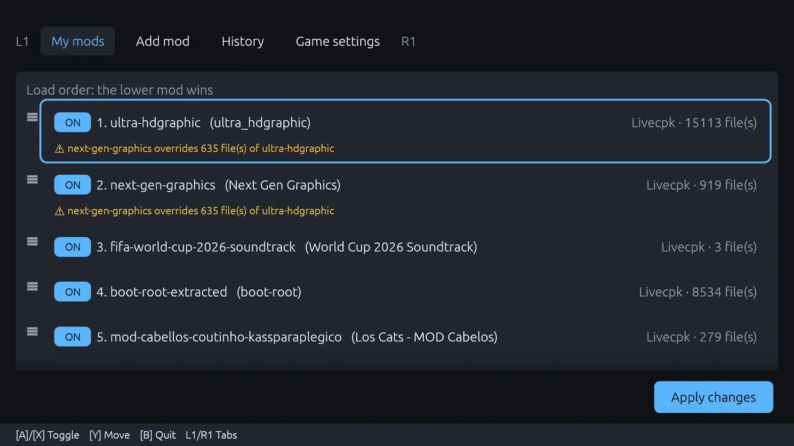
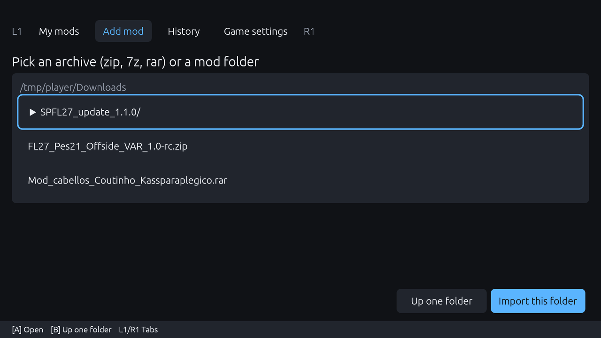
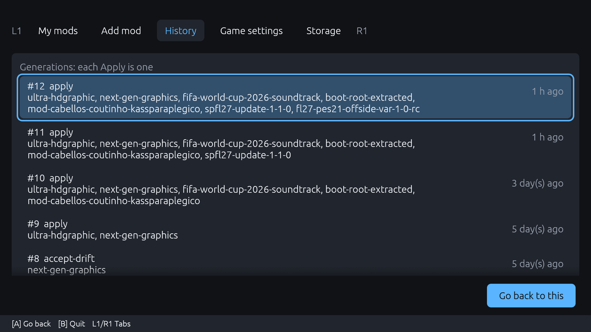
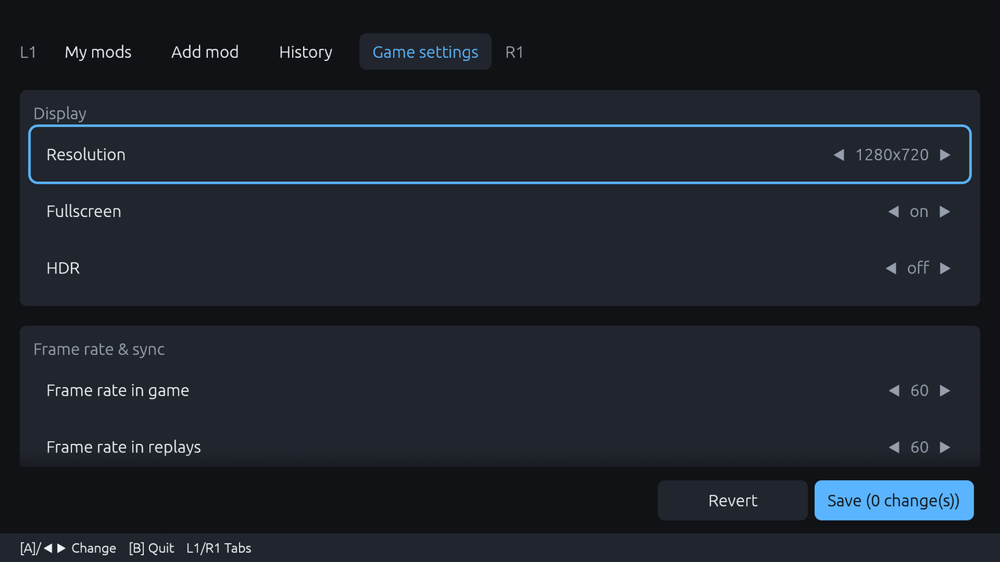

<div align="center">

# fl-modman

**Mods for SP Football Life 2027 on Linux, without the mess.** You keep one list of mods.
fl-modman works out what to copy and which `sider.ini` lines to add, shows you the plan,
applies it, and can undo any apply. Made to be driven with a gamepad, from Steam Gaming Mode.

[](#install)
[](#install)
[](#tested-on)
[](Cargo.toml)
[](LICENSE)
[](https://github.com/NoRoboto/fl-modman/releases/latest)

[Tested on](#tested-on) ·
[My mods](#one-list-the-lower-mod-wins) ·
[Add a mod](#add-a-mod) ·
[History](#every-apply-can-be-undone) ·
[Game settings](#game-settings) ·
[Storage](#storage) ·
[Install](#install) ·
[CLI](#cli) ·
[Safety](#safety)

</div>



## Tested on

> [!IMPORTANT]
> fl-modman is built for **SP Football Life 2027** and tested **only** with it, on an ASUS ROG Ally
> (Bazzite, Steam Gaming Mode, Proton). Other PES 2021 mods, other games and other distros are not
> supported. It may work, but nobody has checked.

## One list, the lower mod wins


**Every mod you add goes on one ordered list.** When two mods touch the same file, the lower one
wins, and the conflict is shown on both. Switch a mod off, move it up or down, press
**Apply changes**: nothing is written until you see the plan.

It knows the five kinds of FL27 mod: livecpk folders, Lua modules, stadiums, `download/*.cpk`
replacements and loose files in the game folder.

## Add a mod



Pick a zip, 7z or rar, or a folder you already extracted. fl-modman finds the mod inside, works out
its type and adds it at the bottom of the list. Mods with odd layouts take a small
[`mod.toml`](docs/mod-toml.md); [`catalog/`](catalog) has ready-made ones for some public mods
(links only, no mod files).

## Every apply can be undone



**Each Apply is a numbered generation.** Pick one and press **Go back to this** to return to it,
files and mod list included. A game update or a file you changed by hand is detected as drift, and
fl-modman asks before it touches anything.

## Game settings



Resolution, fullscreen, HDR, frame rates and the rendering options, edited straight in the game's
`settings.dat`, so you don't need the Windows settings tool under Proton. A backup is made first.

## Storage

The **Storage** tab (and `fl-modman usage`) shows how much space each mod takes, how much of it is
shared with the game, and what the workspace holds in total. **Free** lists the mods that are
switched off and no longer applied, plus leftovers of failed imports, and after you confirm deletes
exactly that list (the same rule as `fl-modman remove --disabled`). Nothing is deleted while the
game runs.

Where the space goes:

- **Mods you switch off keep their files** in the workspace until you remove them. Switching a mod
  off and applying takes it out of the game, not off the disk.
- **Applied files are shared, not copied**, when the workspace and the game are on the same drive:
  the game file and the mod file are one file on disk (a hardlink). If they are on different drives,
  fl-modman has to copy, and every applied file takes its space twice. Storage warns you when that
  happens. Keep the workspace next to the game (the default) to avoid it.
- **Your downloaded archives are never deleted.** After an import you can delete the zip or rar
  yourself; fl-modman keeps its own copy.

## Install

1. Download `fl-modman-<version>-x86_64.AppImage` from
   [Releases](https://github.com/NoRoboto/fl-modman/releases/latest), and check it with
   `sha256sum -c fl-modman-<version>-x86_64.AppImage.sha256`.
2. `chmod +x fl-modman-*.AppImage`
3. Run it. For Gaming Mode, add it to Steam as a non-Steam game.

On the first run it looks for FL27 installs, lets you pick one and takes a snapshot of the game as
it is. That snapshot is your base.

rar archives need `7z`, `7zz`, `unrar` or `bsdtar` on the system; zip and 7z work out of the box.

| Gamepad | Keyboard | |
|:-:|:-:|---|
| <kbd>L1</kbd> <kbd>R1</kbd> | <kbd>Q</kbd> <kbd>E</kbd> | switch tabs |
| <kbd>A</kbd> | <kbd>Enter</kbd> | open, accept |
| <kbd>X</kbd> (or <kbd>A</kbd> on My mods) | <kbd>Space</kbd> | switch a mod on or off |
| <kbd>Y</kbd> | <kbd>M</kbd> | move a mod |
| <kbd>B</kbd> | <kbd>Esc</kbd> | back, quit |

More in [docs/gui.md](docs/gui.md).

## CLI

The AppImage runs the CLI when `cli` is the first argument (`./fl-modman.AppImage cli --help`).
From a source build the binary is `fl-modman`.

```sh
fl-modman detect                          # list FL27 installs and Wine prefixes
fl-modman init ~/Games/FL27               # workspace in ~/Games/fl-modman + base snapshot
export FL_MODMAN=~/Games/fl-modman        # or pass -w <workspace> to each command

fl-modman import ~/Downloads/some-mod.zip # added at the bottom of the list (it wins)
fl-modman apply                           # show the plan only
fl-modman apply --yes                     # write it as a new generation

fl-modman history                         # list generations
fl-modman rollback 1 --yes                # go back to generation 1
```

Stadiums need a team: `fl-modman import <src> --team <id>[,<slot>]`.
All commands: `fl-modman --help` and [docs/engine.md](docs/engine.md).

Mods you installed by hand before `init` stay in place, but fl-modman does not manage them.
Re-import them to manage them.

## Safety

> [!WARNING]
> **Mods can contain code.** `.lua` modules run inside the game through Sider, `.addon64` files are
> ReShade add-ons (native code), and some mods ship `.exe` or `.dll` files. Install only mods from
> sources you trust. fl-modman copies files; it does not scan or sandbox them.

- fl-modman refuses to apply while the game is running.
- A game file a mod replaces is saved first, in `<workspace>/originals/`, so undo can restore it.
  This covers only files that were in the base snapshot taken at `init`.
- Archives are extracted into an empty folder and rejected if they hold symlinks or paths that
  point outside it.
- fl-modman does not edit Steam files. `fl-modman doctor` prints the Proton launch options to paste
  yourself.

## Build from source

Rust 1.96+: `cargo build --release`, or `scripts/build-appimage.sh` for the AppImage.

## License

MIT. See [LICENSE](LICENSE). Not affiliated with Konami or SmokePatch.
